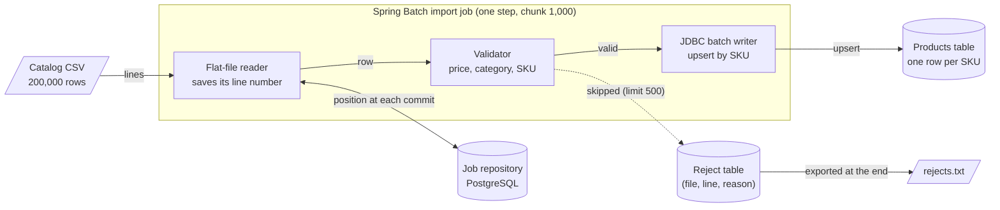

# Architecture: the restartable catalog import

Component names match the lesson's diagram ("The restartable catalog import"): **Catalog CSV**, **Job repository**, **Flat-file reader**, **Validator**, **JDBC batch writer**, **Reject table** and **Products table**, all inside one **Spring Batch import job**.

## Components and what each owns

| Component | Where it lives | What it owns |
| --- | --- | --- |
| **Catalog CSV** | `data/products.csv`, written by [`GenerateCatalogFile`](src/main/java/plainround/catalogimport/application/GenerateCatalogFile.java) | 200,000 rows, 100 planted bad ones (price zero, unknown category, bad SKU, negative price), one every 2,000 rows. |
| **Job repository** | [`sql/001_spring_batch_schema.sql`](sql/001_spring_batch_schema.sql) (Spring Batch's own tables, in PostgreSQL) | Job instances, executions, step executions and their contexts. The reader's saved line number lives in `batch_step_execution_context`, written at every chunk commit. |
| **Flat-file reader** | [`CatalogJobConfiguration#reader`](src/main/java/plainround/catalogimport/infrastructure/batch/CatalogJobConfiguration.java), [`ProductLineMapper`](src/main/java/plainround/catalogimport/infrastructure/batch/ProductLineMapper.java) | Streams the file, keeps the line number in each `ProductRow`, saves its position in the step's execution context. Step-scoped, so each step execution has its own reader. |
| **Validator** | domain [`ProductRules`](src/main/java/plainround/catalogimport/domain/ProductRules.java) (pure, returns a `Result`), adapter [`ProductItemProcessor`](src/main/java/plainround/catalogimport/infrastructure/batch/ProductItemProcessor.java) | The three rules of the lesson, in order. The processor turns a refusal into the one exception the step may skip. It writes nothing. |
| **JDBC batch writer** | [`CatalogJobConfiguration#upsertWriter`](src/main/java/plainround/catalogimport/infrastructure/batch/CatalogJobConfiguration.java) | `INSERT ... ON CONFLICT (sku) DO UPDATE`, 1,000 rows per chunk. A chunk written twice leaves one row per SKU. |
| **Reject table** | [`sql/migrations/001_import_reject.sql`](sql/migrations/001_import_reject.sql), [`JdbcRejectLog`](src/main/java/plainround/catalogimport/infrastructure/jdbc/JdbcRejectLog.java), [`RejectSkipListener`](src/main/java/plainround/catalogimport/infrastructure/batch/RejectSkipListener.java) | One row per refused line, keyed by (file, line), written in the chunk's transaction. `rejects.txt` is exported from it at the end of a run. |
| **Products table** | [`sql/002_catalog_schema.sql`](sql/002_catalog_schema.sql) | One row per SKU. |
| **Run lock** | [`AdvisoryRunLock`](src/main/java/plainround/catalogimport/infrastructure/jdbc/AdvisoryRunLock.java) | A PostgreSQL advisory lock on a connection held for the run. A held lock means a live process; a killed process releases it. |
| **Crash recovery** | [`StaleExecutionRecovery`](src/main/java/plainround/catalogimport/infrastructure/batch/StaleExecutionRecovery.java) | Marks executions left STARTED by a dead process as FAILED (keeping their counts), so the same parameters can restart. |
| **Use case** | [`ImportCatalog`](src/main/java/plainround/catalogimport/application/ImportCatalog.java) | Take the lock, recover, run the job, export the rejects. |

The ports are `RunLock`, `CrashRecovery`, `ImportJob` and `RejectLog` in `application`; Spring Batch, JDBC and the file system implement them in `infrastructure`.

## Pattern: ports and adapters around a chunk-oriented step

The batch framework is infrastructure: the job, its step, the reader, the writer and the listeners are Spring Batch beans in `infrastructure.batch`. The business rules (what makes a product valid, what a refusal looks like) are plain Java in `domain` and return a `Result` (Result4J) instead of throwing; the processor, which has to throw because Spring Batch's skip policy is driven by exceptions, is the single place where a `Result` becomes an exception (`orOnErrorThrow`). The `ImportCatalog` use case knows nothing about Spring Batch: it asks four ports. `ArchitectureTest` enforces the layers (domain depends on nothing, application on domain, nothing on interfaces) and bans Spring from `domain` and `application`. See [ADR 1](docs/adr/0001-ports-and-adapters-around-spring-batch.md).

## Data flow

### One run, step by step (`make run`)

1. `make db` creates the job repository tables, `product`, and (as a migration) `import_reject`. `make generate` writes `data/products.csv`.
2. `ImportRunner` reads `--import.file` and `--run.id`, builds an `ImportRequest` and calls `ImportCatalog`.
3. The use case takes the advisory lock (`pg_try_advisory_lock`) on a dedicated connection. If another process holds it, the run ends with status BLOCKED and exit code 4.
4. `StaleExecutionRecovery` asks the job explorer for executions still marked running and marks them (and their running steps) FAILED. With the lock held, they can only belong to dead processes.
5. `SpringBatchImportJob` launches the job with parameters `file` and `run.id`. The pair is the job instance's identity: a new pair starts at line 1; the same pair as a failed instance resumes. The same pair as a completed instance is refused (`JobInstanceAlreadyCompleteException`, exit code 3).
6. The step reads a chunk of up to 1,000 lines, validates each row, upserts the valid ones with one batched statement, and commits. In the same transaction Spring Batch updates the step execution's counters and saves the reader's position. A refused row throws `InvalidProductException`, which the step skips (limit 500 over the step) after `RejectSkipListener` has recorded the line and the reason.
7. A transient database error on a write (`TransientDataAccessException`) is retried up to 3 times; any other error fails the step at once.
8. After the job, the use case exports `rejects.txt` from the reject table, sorted by line, and releases the lock. The runner prints `COMPLETED read=200000 written=199900 skipped=100 commits=201 ...` and exits 0.

## Decisions and trade-offs

**Chunk size 1,000, one step.** A bigger chunk means fewer commits and a bigger replay after a crash; 1,000 rows of this width is a few hundred kilobytes and about 200 commits for the file. A chunk is the unit of progress: the repository never knows more than the last commit.

**The upsert key is the business key (SKU)** ([ADR 2](docs/adr/0002-upsert-by-business-key.md)). With a generated id every write would be a new row and the table would double on a restart. With the SKU the second write of a chunk changes nothing.

**Skip exactly one exception, and record the skip in the chunk's transaction** ([ADR 3](docs/adr/0003-skip-one-exception-record-in-the-database.md)). `skip(Exception.class)` would swallow real bugs. The reject record is a table keyed by (file, line), written inside the chunk's transaction, because a file appended to by a listener duplicates lines when a chunk is processed again after a crash, and a log line alone rotates away. The file is a view of the table.

**Retry only `TransientDataAccessException`.** A constraint violation fails the same way every time; retrying it three times only delays the error. The integration test counts the writer's invocations to prove it is called once.

**Recovery of STARTED executions under a lock** ([ADR 4](docs/adr/0004-recover-crashed-runs-under-an-advisory-lock.md)). Spring Batch refuses to launch a job instance whose last execution is still recorded as running. After `kill -9` that is always the case. Marking it failed is correct only if no live process owns it; the advisory lock is that proof, and it disappears with its owner.

**Graceful stop.** On SIGTERM or SIGINT a shutdown hook asks every step execution to stop after the chunk in flight and waits up to 60 seconds. The chunk commits, the position is saved, and the next start resumes cleanly. (`kill -9` cannot be handled, which is why recovery exists.)

**Configuration and observability.** Settings come from the environment and `application.yml` and are validated at startup (`ImportProperties`). The log is one JSON object per line on standard error, the report and tables are on standard output, and the exit code is the report's: 0 completed, 1 failed or stopped, 2 unknown command, 3 same run already completed, 4 blocked by another run. `--command=health` checks the database and the table.

## Failure modes the lesson teaches, and how to reproduce each

| Failure | What you see | Reproduce |
| --- | --- | --- |
| **Bad rows** | `skipped=100`; `rejects.txt` has 100 lines like `line 2001: SKU-002000,weapons,295.31 -> unknown category weapons` | `make run` |
| **Too many bad rows** | `FAILED ... Skip limit of '500' exceeded` | `make too-many-bad` |
| **A crash in the middle** (`kill -9`) | the first step execution stays `STARTED` with its last commit's counts; the restart marks it failed, resumes at the saved line, and the two executions add up to the file | `make crash-test` |
| **Running the whole thing again** | with a new `run.id`: still 199,900 rows. With the same `run.id`: `ALREADY_COMPLETE`, exit 3 | `make run-new-id`, `make run-twice` |
| **A transient write failure** | every fiftieth chunk fails once and is retried; `skip_count` stays 100 | `make retry-demo` |
| **A failure that can never succeed** | the step fails at once, the writer is called once | `CrashAndRecoveryIT#a_failure_that_can_never_succeed_is_written_once_and_not_retried` |
| **A second process at the same time** | status BLOCKED, exit 4 | `CatalogImportIT#a_second_process_cannot_take_the_lock_while_the_first_holds_it` |

## Limits of the teaching build against production

- **One file, one node, one step.** A catalog that arrives as many files, or a step that must scale, needs partitioning (the next project in this track).
- **A skip limit counts per execution.** After a restart the count starts at zero again, so a file can exceed its limit across restarts. A production job would also check the reject table's size.
- **The advisory lock is per database, with one fixed key.** Two different imports against one database would block each other; production derives the key from the job name and file.
- **The reject table grows.** Production prunes it or partitions it by month.
- **The file is read from a local path.** Production reads from object storage and verifies a checksum before starting (an input that changed between a crash and the restart would make the saved line number wrong).
- **Credentials.** A throwaway password in `.env`, a plain-text connection, no TLS.
- **No metrics endpoint.** The counters are in the job repository and the report; the next project in the track adds Micrometer.

## How to extend it

- **Read from a database table** (stretch): replace the flat-file reader with a `JdbcPagingItemReader` ordered by a unique key; its saved page keeps restart working, and the same upsert makes the write safe.
- **Archive the input file** (stretch): add a second step that runs only if `importStep` completed (`.next(archiveStep)` on the `COMPLETED` status).
- **Expose status and start jobs over HTTP** (stretch): add a thin `interfaces.web` package with a controller calling `ImportCatalog` and a query port over the job repository; `ArchitectureTest` already forbids anything from depending on it.
